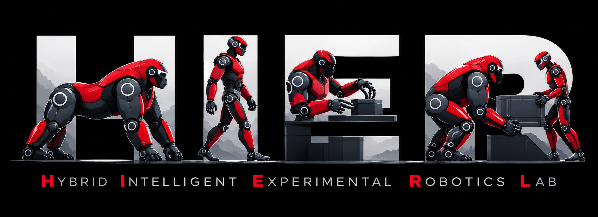
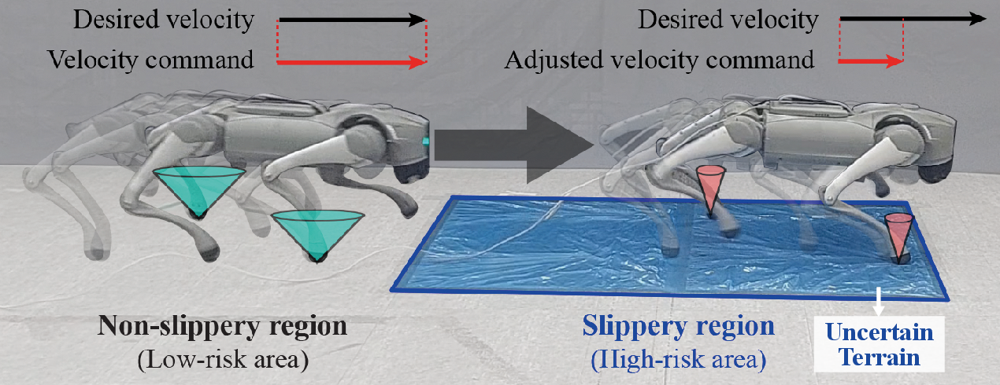
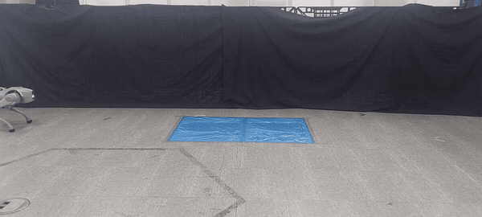
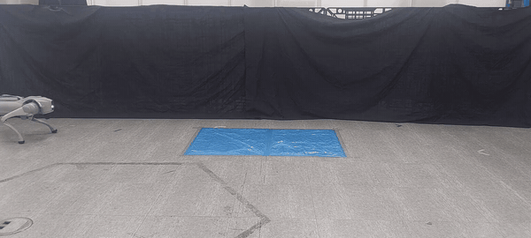
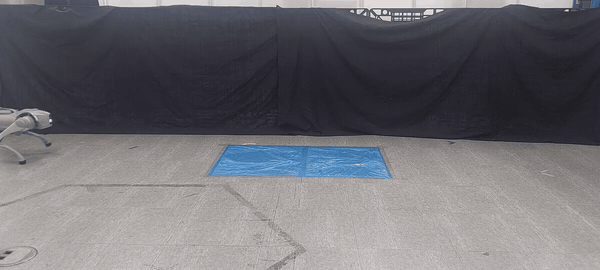
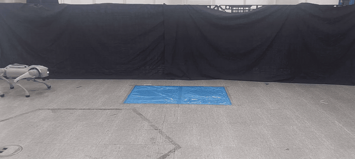

# LA-WBC

<p align="center">
  
  &nbsp;&nbsp;&nbsp;
  
  &nbsp;&nbsp;&nbsp;
  
</p>

This repository provides code-base pipeline for data processing, training, and cost-map analysis for **LA-WBC**, Learning-driven Adaptation of Whole-Body Control framework. This work aims to adjust the critical parameters of whole-body controller for quadrupedal locomotion so that robots are able to adapt to uncertain terrain friction. Project page: [LA-WBC](https://2nitrogen.github.io/LA-WBC_project-page/)

A Unitree Go2 is simulated in MuJoCo, walking under a model-based whole-body controller over a grid of terrain friction (`mu_terrain`), contact-wrench cone constraints in WBC (`mu_ctrl`), and forward velocity command (`vx_cmd`). The recorded proprioceptive data are used for two things:

1. **Friction estimation.** Neural networks (FCNN, GRU, Transformer, RecGNN) are trained to regress `mu_terrain` from a short history of base velocity, joint states, and the controller's desired torque `u_des` (command-response). A feature scale factor `alpha` for the torque channel is computed from the input covariance and applied to an additional RecGNN.
2. **Cost map.** Each episode is evaluated on velocity tracking, cost of transport, and gait stability. The precomputed scores are combined into a 3-D cost map over `(mu_terrain, mu_ctrl, vx_cmd)` grid, which is used to adjust the parameters in WBC later.

<p align="center">
  
</p>

### Hardware experiments

<table align="center">
  <tr>
    <th></th>
    <th>Without adaptation</th>
    <th>LA-WBC (ours)</th>
  </tr>
  <tr>
    <th>0.5 m/s</th>
    <td></td>
    <td></td>
  </tr>
  <tr>
    <th>0.7 m/s</th>
    <td></td>
    <td></td>
  </tr>
</table>

## Layout

```
.
├── scripts/
│   ├── download_dataset.py    # Download raw episodes from the Hugging Face Hub
│   ├── process_dataset.py     # Raw episodes -> processed_dataset.h5
│   ├── train.py               # Train FCNN / GRU / Transformer / RecGNN (+ alpha-scaled RecGNN)
│   ├── compute_cost_map.py    # 3-D locomotion cost map (mu_terrain x mu_ctrl x vx_cmd)
│   └── run.sh                 # End-to-end pipeline
└── lawbc/                     # Library code used by the scripts
    ├── models/
    │   ├── model.py           # Model architectures
    │   └── *_cfg.yaml         # Per-model hyperparameters
    └── utils/
        ├── dataloader.py      # Windowed dataset, normalization, data loaders
        ├── trainer.py         # Training loop
        ├── scaling_factor_optimizer.py  # Torque-channel scale (alpha) optimization
        ├── metrics.py         # Locomotion metrics for the cost map
        ├── frame_transforms.py  # Body-frame transforms, contact & flip detection
        └── util.py            # Plotting, TorchScript export, filters, seeding
```

## Setup

```bash
git clone <repo-url> LA-WBC && cd LA-WBC
conda env create -f environment.yml   # dependencies + this repo (`pip install -e .`)
conda activate lawbc
```

Without conda, run `pip install -e .` in Python ≥ 3.10. To use a specific CUDA build of PyTorch, install it from [pytorch.org](https://pytorch.org/get-started/locally/) first.

Run all commands from the repository root.

## Dataset

The raw simulation data is hosted on the Hugging Face Hub at [`2Nitrogen/LA-WBC`](https://huggingface.co/datasets/2Nitrogen/LA-WBC). It has two subsets of about 6 GB each:

| Subset | Description |
|---|---|
| `w_cont_id`  | Controller **with** contact model matching |
| `wo_cont_id` | Controller **without** contact model matching |

Each subset holds 1,183 episodes of 8 s at 1 kHz. They cover `mu_terrain` ∈ {0.1, …, 1.3}, `mu_ctrl` ∈ {0.1, …, 1.3}, and `vx_cmd` ∈ {0.1, …, 0.7} m/s.

```bash
python scripts/download_dataset.py                      # both subsets -> ./dataset
python scripts/download_dataset.py --subset w_cont_id   # a single subset
```

You can also use the Hugging Face CLI:

```bash
hf download 2Nitrogen/LA-WBC --repo-type dataset --local-dir dataset
```

Layout after download:

```
dataset/<subset>/<run_id>/
├── index.csv          # one row per episode: params, status, n_steps, path
├── manifest.json      # run-level metadata
└── episodes/epXXXXXX/
    ├── data.h5        # /data/value: structured array (q, qd, u, u_des, f, feet_pos, ...)
    └── meta.json      # episode params (mu_terrain, mu_ctrl, vx_cmd, ...) and status
```

## Usage

To run the whole pipeline (preprocess → cost map → train) for every downloaded subset:

```bash
scripts/run.sh                          # all subsets
SUBSETS=w_cont_id GPU=0 scripts/run.sh  # one subset on GPU 0
```

The individual steps are listed below. All outputs go to `results/`. All hyperparameters are fixed to the values used in the paper.

<details>
<summary><b>1. Preprocess</b></summary>

This step trims the first 2,000 steps of each episode (the stand-up transient) and adds body-frame velocities, contact events, and per-timestep `mu_terrain` labels, with flipped segments labeled 0. The result is one `processed_dataset.h5` written next to `episodes/`.

```bash
python scripts/process_dataset.py --src dataset/w_cont_id/2026-02-04_18-30-04_w_cont_id
```

</details>

<details>
<summary><b>2. Train</b></summary>

```bash
python scripts/train.py --data_dir dataset/w_cont_id --out_dir w_cont_id --gpu_id 0
```

`--data_dir` is searched recursively for `processed_dataset.h5`. Episodes are split 80/20 into train and test sets. The script trains the four models (FCNN, GRU, Transformer, RecGNN), solves for the torque-channel scale `alpha`.

Outputs in `results/<out_dir>/`:

| File | Content |
|---|---|
| `<model>.ts.pt`, `<model>_state.pt` | TorchScript model / `state_dict` (best test MAE) |
| `norm_stats.json` | Input normalization statistics (required for inference) |
| `train_config.json` | Settings of the run |
| `loss_log.json`, `*_mse.svg`, `*_mae.svg` | Loss curves (incl. `optimal_alpha`) |
| `<model>_pred.csv`, `*_scatter.png`, `*_pred_stats.png` | Test-set predictions |
| `measurement_report.json` | Dataset sizes and timings |

</details>

<details>
<summary><b>3. Cost map</b></summary>

```bash
python scripts/compute_cost_map.py \
  --data dataset/w_cont_id/2026-02-04_18-30-04_w_cont_id \
  --output results/cost_maps/cost_map_w_cont_id.npz
```

Each metric is min-max normalized over the grid. The normalized metrics are combined with weights of 1.0 for `vel_track_error`, 1.0 for `cost_of_transport`, and 0.2 for `stability_periodic_wobble` (with `beta` = 0.5), normalized to sum to 1. These settings are defined at the top of `scripts/compute_cost_map.py`. Episodes where the robot flips are excluded. Cells where every episode flipped are assigned the worst cost.

</details>

## Development notes

- Evaluation code for hardware experiment data (real-time inference on logs from the physical Go2) will be released later.
